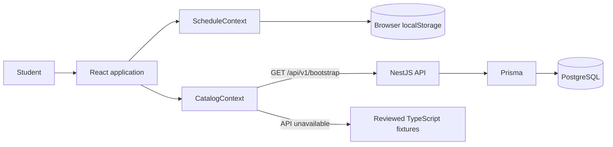
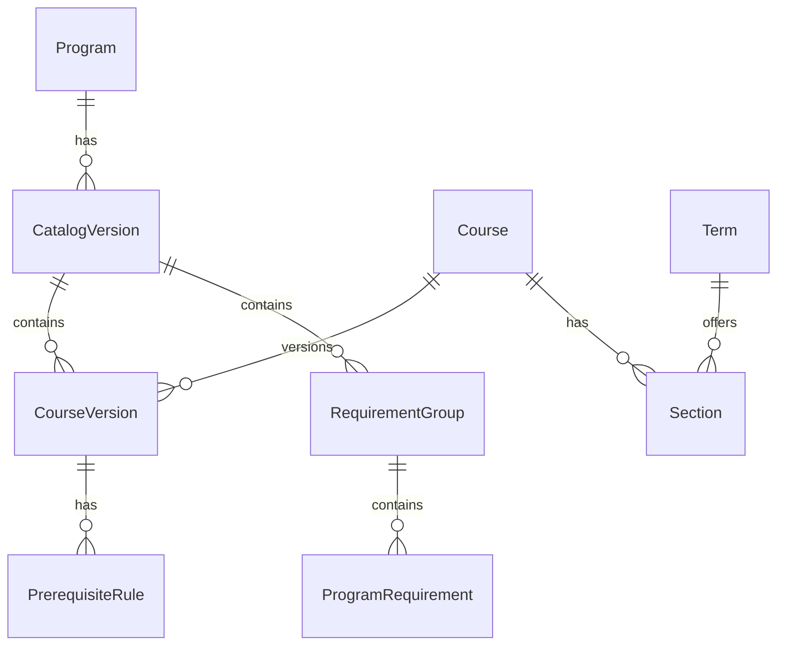

# Course Radar: Current System Architecture

Last reviewed against the local codebase: 2026-09-11

This document describes only what exists in the current codebase. Remaining schedule-builder work is documented separately in `ScheduleCreationPlan.md`.

## System overview

Course Radar is a React/Vite frontend with an optional NestJS/PostgreSQL data service. It supports SJSU Computer Engineering and Software Engineering catalog data for 2026-2027.



The frontend remains usable without the API. `CatalogContext` loads the matching local fixture first, requests the backend catalog, and replaces the fixture only when the response passes its compatibility checks.

## Frontend

`src/main.tsx` mounts `CatalogProvider` and `ScheduleProvider`, then defines the application routes.

| Route | Current responsibility |
| --- | --- |
| `/` | Student overview and progress summary |
| `/courses` | Search courses, select Fall 2026 sections, and view a weekly schedule |
| `/roadmap` | Eight-semester degree roadmap |
| `/prerequisite-chart` | Prerequisite/corequisite graph |
| `/planner` | Course-level semester planning |
| `/recommendations` | Non-functional feature preview |
| `/design-preview` | Standalone design preview |

`src/Workspace.tsx` supplies the shared navigation, selected program, catalog status, and route outlet. It also contains the Overview, Courses, Planner, and Recommendations page components.

`src/App.tsx` contains the roadmap and exports the shared `CourseDetail` drawer. The drawer displays course details, prerequisite/corequisite information, planning controls, and section offerings.

`src/ScheduleContext.tsx` owns browser-persisted section selections. `src/schedule.ts` parses meeting strings and detects overlaps without depending on React. `src/WeeklySchedule.tsx` renders the hourly calendar, selected-section summary, TBA rows, and conflict messages.

`src/PrerequisiteChart.tsx` renders the roadmap-course dependency graph. `src/CourseState.tsx` derives visual states such as taken, planned, in progress, open, closed, and missing prerequisite.

## Current state ownership

Personal state is split across two contexts:

```text
Catalog state
├── selected program
├── loaded catalog
├── database/fixture mode
└── retry action

Student session state
├── takenCourseIds
└── plans by program
    └── courseId -> status + numbered semester

ScheduleContext
└── schedules by program + catalog year + term
    └── selected class numbers
```

Taken courses and the eight-semester plan exist only in React memory and reset on refresh. Schedule selections use versioned browser `localStorage` and survive refresh on the same browser. There is no student account, user ID, cross-device synchronization, or backend plan record.

The current plan stores one course-level entry containing:

```ts
{
  status: "planned" | "in-progress";
  semester: number;
}
```

It does not store a real term ID or selected class section. Schedule selections are a separate Fall 2026 concern and do not mutate this planner model.

## Current planner behavior

The planner renders eight numbered semester cards from the program requirement groups. It can add, move, and remove courses and show total units.

Its prerequisite warning checks whether each recorded prerequisite is in `takenCourseIds`. It does not evaluate a prerequisite placed in an earlier planned semester, grouped AND/OR rules, minimum grades, or same-semester corequisite behavior.

The course drawer displays Fall 2026 sections and provides an explicit Add/Added/Replace action. Selecting the first section reveals the weekly schedule. Only one section per course component is kept, so replacing a lecture does not remove a separately selected lab.

The schedule parser converts supported day/time strings into day and minute ranges in the frontend. The conflict detector compares selected sections pairwise using half-open time intervals. It does not check prerequisites, rank schedules, choose sections automatically, or perform registration. TBA/unparseable sections remain visible as unverifiable rows.

## Frontend data contract

`src/types.ts` defines `ProgramCatalog`, `Course`, `RequirementGroup`, and `CourseOffering`.

```text
ProgramCatalog
├── program and catalog metadata
├── currentTerm
├── courses
│   ├── prerequisiteCourseIds
│   └── corequisiteCourseIds
├── requirementGroups
└── offerings
    ├── classNumber and sectionNumber
    ├── component and mode
    ├── days, times, and dates
    ├── location and instructors
    └── openSeats
```

Meeting days, times, and dates arrive as display strings. `src/schedule.ts` derives normalized meeting values at runtime for the current V1; Prisma and the bootstrap DTO do not yet store/return normalized meeting child records.

## Backend

The backend under `api/` is a NestJS modular monolith:

```text
AppModule
├── PrismaModule
├── CatalogModule
├── CoursesModule
├── BootstrapController
└── HealthController
```

`api/src/main.ts` applies the `/api/v1` prefix, enables CORS for the frontend origin, and listens on port 3001 by default.

Current endpoints:

- `GET /api/v1/health`
- `GET /api/v1/bootstrap?program=...`

There is no current schedule-creation or plan-validation endpoint.

## Database

Prisma models programs, catalog versions, course versions, prerequisite rules, requirement groups/items, source snapshots, terms, and sections.



`PrerequisiteRule` already contains `groupKey`, `AND`/`OR`, `minimumGrade`, `isCorequisite`, and `requiresManualReview`. The bootstrap response currently flattens these records into prerequisite and corequisite ID arrays, so the richer rule information does not reach the frontend.

`Section` stores `days`, `times`, and `dates` as strings and has no normalized child meeting records. No student-plan tables exist.

## Data ingestion

1. Reviewed catalogs live in `src/data.ts` and `src/softwareEngineeringData.ts`.
2. `scripts/import-fall-2026-schedule.mjs` imports the official Fall 2026 schedule into `src/fall2026Offerings.generated.ts`.
3. React uses these files as its offline fallback.
4. `api/prisma/seed.ts` imports the same repository data into PostgreSQL.
5. NestJS reads it through Prisma and returns the frontend bootstrap shape.

`docker-compose.yml` runs PostgreSQL 17 and the NestJS API. The Vite frontend runs separately and can fall back to its reviewed fixtures when these services are unavailable.

## Current architecture boundary

| Data | Current owner | Persistence |
| --- | --- | --- |
| Degree catalog and prerequisite records | Repository fixtures and PostgreSQL | Persistent |
| Term offerings and seat snapshots | Generated fixture and PostgreSQL | Persistent snapshot |
| Taken courses and semester plan | `CatalogContext` | Browser memory only |
| Selected Fall 2026 sections | `ScheduleContext` | Versioned browser `localStorage` |

The schedule builder deliberately remains separate from the numbered-semester plan. A future authenticated design may unify them behind stable real-term IDs, normalized meeting records, and a persistence API; none of those future boundaries are implied by the current browser-owned implementation.
